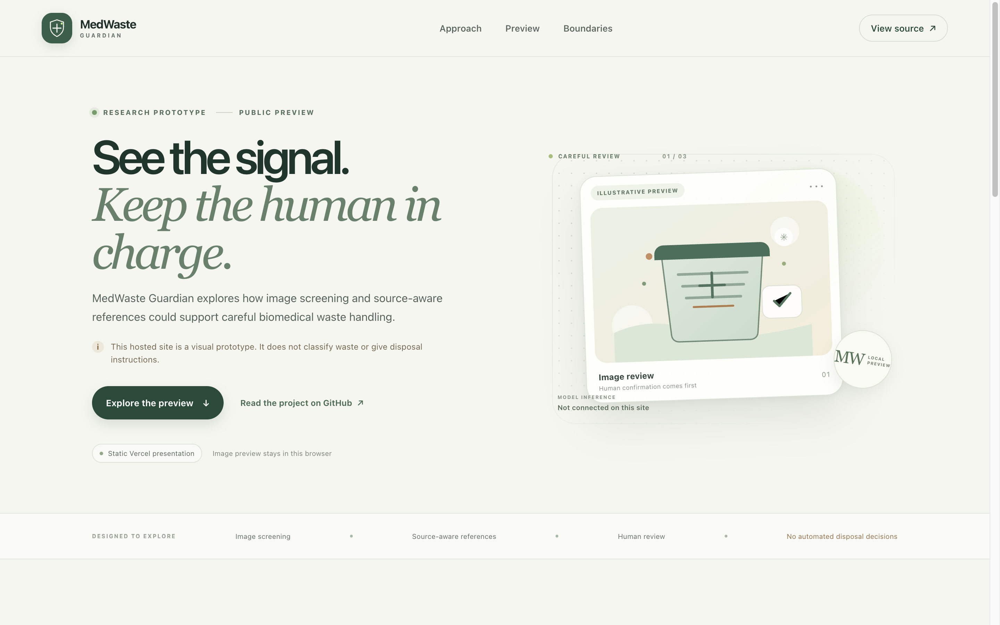
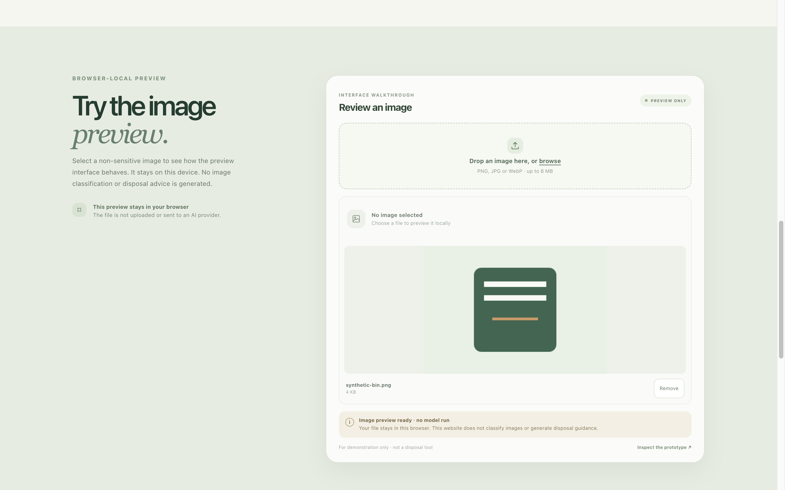
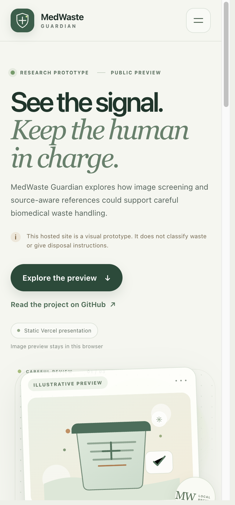

<p align="center">
  
</p>

<h1 align="center">MedWaste Guardian</h1>

<p align="center">
  <a href="https://github.com/ayushcodes13/MedWaste-Guardian"></a>
  <a href="https://medwaste-guardian-site.vercel.app/"></a>
  
  
</p>

<p align="center">A research prototype exploring biomedical-waste image screening and source-aware references, with a public static site that previews images locally and makes its limits explicit.</p>

> **The website does not classify waste or provide clinical, legal, or disposal guidance.** The image model and retrieval services are not connected to the hosted site.

## Website

**Production website:** [medwaste-guardian-site.vercel.app](https://medwaste-guardian-site.vercel.app/)

**Custom domain:** `medwaste.devayushrout.me` is attached to the Vercel project but still needs DNS ownership verification at Namecheap. The `vercel.app` production URL is live while that is pending.

The website is designed to explain the project honestly and provide a small, safe interaction: choose a non-sensitive PNG, JPG, or WebP image up to 8 MB and preview it in the browser. The file is not uploaded. No inference, retrieval, or disposal recommendation runs.

**Intended audience:** people reviewing the research prototype and developers exploring human-reviewed decision-support interfaces. It is not an operational hospital tool.

## Screenshots

| Desktop home | Browser-local image preview |
| --- | --- |
|  |  |

**Responsive home**



Screenshots were captured from the running site in Aside Browser using a synthetic image. They show the current static presentation, not a model result.

## What this repository contains

- `site/` — the static, responsive portfolio website. It needs no build step or environment variables.
- `app.py` — an experimental Flask app with image, text-query, and speech endpoints. Startup loads a YOLO weight, a Hugging Face Llama model, and an embedding model.
- `ragapi.py` — a separate experimental FastAPI/LlamaIndex service. It loads the local `medwaste_index/` and the same Hugging Face model family.
- `WasteClassification/` — YOLO training and experiment artifacts; the tracked `backend/models/yolov8_medical_waste_best.pt` is the weight referenced by `app.py`.
- `medwaste_index/` — a local LlamaIndex storage snapshot.
- `templates/` and `Legal Compilance/` — older UI and notebook-era experiments.

The Python services are not the deployment behind the website. Their full local workflow has not been verified in this completion pass. In particular, `app.py` calls the RAG API at `http://localhost:8000/query/`, model downloads may require Hugging Face access, the dependency list is broad and unpinned, and the separate `WasteClassification/yolo_api.py` contains a machine-specific path. Treat those files as research code, not a maintained service.

## Run the website locally

Python 3 is enough for the static site; there is no package install or build step.

```bash
python3 -m http.server 4173 --directory site
```

Open `http://localhost:4173`. The image preview runs in the browser and accepts PNG, JPEG, and WebP files up to 8 MB. It does not send them to a server.

## Deploy the website on Vercel

Configure the Vercel project as a static site:

- **Root Directory:** `site`
- **Framework preset:** Other
- **Build command:** none
- **Output directory:** `.`
- **Install command:** none
- **Environment variables:** none

The Vercel project is named `medwaste-guardian-site`. Its production deployment is connected to the GitHub `main` branch.

This publishes the presentation and browser-local preview only. It does not deploy the Flask/FastAPI services, model weights, RAG index, microphone workflow, or any medical-waste decision support.

## Experimental Python services

The repository includes a `requirements.txt`, but it is unpinned and installs a large machine-learning stack. The original application loads models during module startup, expects the local index and YOLO weight, and calls two services on localhost. The code and its dependencies have not been verified as a reproducible end-to-end workflow here; there is no supported installation guarantee yet.

Do not use these services for actual waste handling. Before making them remotely accessible, the project would need a reproducible environment, configurable service URLs and model paths, validated source material, authentication, privacy review, and a trained human-review workflow.

## Verification in this pass

- `node --check site/app.js` — passed.
- Served `site/` locally with Python's static HTTP server — page loaded in Aside Browser.
- Selected a synthetic PNG — preview rendered locally and the interface reported “no model run.”
- Opened the Vercel production URL in Aside Browser and exercised the same synthetic PNG preview; the image loaded in-browser, no inference ran, and selecting the file created no additional network resource requests.
- Selected a text file — the UI rejected it with a clear message.
- Removed the preview — the UI returned to the empty state.
- Checked the 390 px mobile layout — no horizontal overflow; mobile navigation opened, followed the Preview link, and closed.
- Checked screenshots for layout and content. The tested interaction uses a synthetic image and does not validate any classifier or backend.

## Privacy and safety

Use only synthetic or otherwise non-sensitive sample images. The public preview creates an object URL in the current browser tab and does not upload the file. The site gives no waste classification, regulatory interpretation, or disposal instruction. Real handling decisions must follow facility procedures and applicable local requirements with trained human review.
